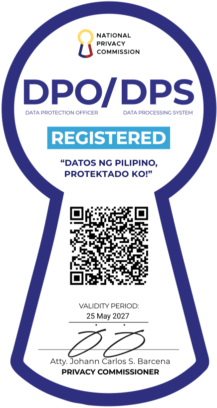
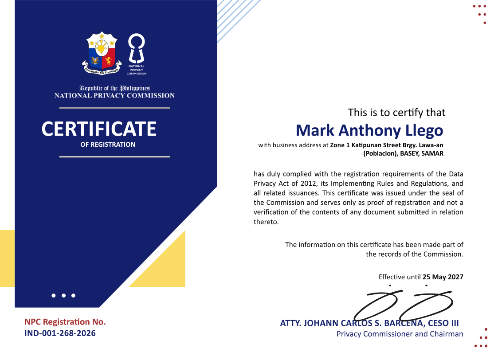

# Hi, I'm Mark Anthony Llego 👋

**Full-stack developer building AI-powered web apps with Next.js, TanStack Start, React, and Cloudflare.**

I'm a developer in the Philippines (UTC+8). I've been building and running websites for over ten years. I started with WordPress and SEO, and these days I mostly build TypeScript and React apps with AI features, deployed on Cloudflare. I work through my registered business, Edventure Web Development Services, and I run my own sites and apps too, so I handle hosting, monitoring, and search traffic after launch.

## What I build

- **AI features in web apps**: chat, document search (RAG), OCR, structured data extraction, and tool-using agents on Claude, OpenAI, Gemini, DeepSeek, GLM, and Mistral models.
- **Apps on Cloudflare**: Workers, D1, R2, KV, Durable Objects, Workers AI, and the Agents SDK. They run close to users worldwide and cost little to host.
- **Full-stack React**: Next.js, TanStack Start, and React Router apps with Clerk auth, TanStack Query, Hono APIs, Drizzle, and Zod.
- **Python tools**: scripts, bots, and small services built on the Anthropic and Google Gen AI SDKs.
- **Content sites that rank**: Astro and WordPress sites built with Core Web Vitals, structured data, and technical SEO in mind.

## Tech stack

| Area | Tools |
|---|---|
| **Languages** |     |
| **Frontend** |          |
| **Backend & data** |         |
| **Cloud** |     |
| **AI** |  ![OpenAI](https://img.shields.io/badge/OpenAI-18181b?style=flat-square&logo=data:image%2Fsvg%2Bxml;base64,PHN2ZyBmaWxsPSIjZmZmZmZmIiBmaWxsLXJ1bGU9ImV2ZW5vZGQiIHZpZXdCb3g9IjAgMCAyNCAyNCIgeG1sbnM9Imh0dHA6Ly93d3cudzMub3JnLzIwMDAvc3ZnIj48cGF0aCBkPSJNOS4yMDUgOC42NTh2LTIuMjZjMC0uMTkuMDcyLS4zMzMuMjM4LS40MjhsNC41NDMtMi42MTZjLjYxOS0uMzU3IDEuMzU2LS41MjMgMi4xMTctLjUyMyAyLjg1NCAwIDQuNjYyIDIuMjEyIDQuNjYyIDQuNTY2IDAgLjE2NyAwIC4zNTctLjAyNC41NDdsLTQuNzEtMi43NTlhLjc5Ny43OTcgMCAwMC0uODU2IDBsLTUuOTcgMy40NzN6bTEwLjYwOSA4LjhWMTIuMDZjMC0uMzMzLS4xNDMtLjU3LS40MjktLjczN2wtNS45Ny0zLjQ3MyAxLjk1LTEuMTE4YS40MzMuNDMzIDAgMDEuNDc2IDBsNC41NDMgMi42MTdjMS4zMDkuNzYgMi4xODkgMi4zNzggMi4xODkgMy45NDggMCAxLjgwOC0xLjA3IDMuNDczLTIuNzYgNC4xNjN6TTcuODAyIDEyLjcwM2wtMS45NS0xLjE0MmMtLjE2Ny0uMDk1LS4yMzktLjIzOC0uMjM5LS40MjhWNS44OTljMC0yLjU0NSAxLjk1LTQuNDcyIDQuNTkxLTQuNDcyIDEgMCAxLjkyNy4zMzMgMi43MTIuOTI4TDguMjMgNS4wNjdjLS4yODUuMTY2LS40MjguNDA0LS40MjguNzM3djYuODk4ek0xMiAxNS4xMjhsLTIuNzk1LTEuNTd2LTMuMzNMMTIgOC42NThsMi43OTUgMS41N3YzLjMzTDEyIDE1LjEyOHptMS43OTYgNy4yM2MtMSAwLTEuOTI3LS4zMzItMi43MTItLjkyN2w0LjY4Ni0yLjcxMmMuMjg1LS4xNjYuNDI4LS40MDQuNDI4LS43Mzd2LTYuODk4bDEuOTc0IDEuMTQyYy4xNjcuMDk1LjIzOC4yMzguMjM4LjQyOHY1LjIzM2MwIDIuNTQ1LTEuOTc0IDQuNDcyLTQuNjE0IDQuNDcyem0tNS42MzctNS4zMDNsLTQuNTQ0LTIuNjE3Yy0xLjMwOC0uNzYxLTIuMTg4LTIuMzc4LTIuMTg4LTMuOTQ4QTQuNDgyIDQuNDgyIDAgMDE0LjIxIDYuMzI3djUuNDIzYzAgLjMzMy4xNDMuNTcxLjQyOC43MzhsNS45NDcgMy40NDktMS45NSAxLjExOGEuNDMyLjQzMiAwIDAxLS40NzYgMHptLS4yNjIgMy45Yy0yLjY4OCAwLTQuNjYyLTIuMDIxLTQuNjYyLTQuNTE5IDAtLjE5LjAyNC0uMzguMDQ3LS41N2w0LjY4NiAyLjcxYy4yODYuMTY3LjU3MS4xNjcuODU2IDBsNS45Ny0zLjQ0OHYyLjI2YzAgLjE5LS4wNy4zMzMtLjIzNy40MjhsLTQuNTQzIDIuNjE2Yy0uNjE5LjM1Ny0xLjM1Ni41MjMtMi4xMTcuNTIzem01Ljg5OSAyLjgzYTUuOTQ3IDUuOTQ3IDAgMDA1LjgyNy00Ljc1NkMyMi4yODcgMTguMzM5IDI0IDE1Ljg0IDI0IDEzLjI5NmMwLTEuNjY1LS43MTMtMy4yODItMS45OTgtNC40NDguMTE5LS41LjE5LS45OTkuMTktMS40OTggMC0zLjQwMS0yLjc1OS01Ljk0Ny01Ljk0Ni01Ljk0Ny0uNjQyIDAtMS4yNi4wOTUtMS44OC4zMUE1Ljk2MiA1Ljk2MiAwIDAwMTAuMjA1IDBhNS45NDcgNS45NDcgMCAwMC01LjgyNyA0Ljc1N0MxLjcxMyA1LjQ0NyAwIDcuOTQ1IDAgMTAuNDljMCAxLjY2Ni43MTMgMy4yODMgMS45OTggNC40NDgtLjExOS41LS4xOSAxLS4xOSAxLjQ5OSAwIDMuNDAxIDIuNzU5IDUuOTQ2IDUuOTQ2IDUuOTQ2LjY0MiAwIDEuMjYtLjA5NSAxLjg4LS4zMDlhNS45NiA1Ljk2IDAgMDA0LjE2MiAxLjcxM3oiPjwvcGF0aD48L3N2Zz4%3D) ![ChatGPT](https://img.shields.io/badge/ChatGPT-18181b?style=flat-square&logo=data:image%2Fsvg%2Bxml;base64,PHN2ZyBmaWxsPSIjZmZmZmZmIiBmaWxsLXJ1bGU9ImV2ZW5vZGQiIHZpZXdCb3g9IjAgMCAyNCAyNCIgeG1sbnM9Imh0dHA6Ly93d3cudzMub3JnLzIwMDAvc3ZnIj48cGF0aCBkPSJNOS4yMDUgOC42NTh2LTIuMjZjMC0uMTkuMDcyLS4zMzMuMjM4LS40MjhsNC41NDMtMi42MTZjLjYxOS0uMzU3IDEuMzU2LS41MjMgMi4xMTctLjUyMyAyLjg1NCAwIDQuNjYyIDIuMjEyIDQuNjYyIDQuNTY2IDAgLjE2NyAwIC4zNTctLjAyNC41NDdsLTQuNzEtMi43NTlhLjc5Ny43OTcgMCAwMC0uODU2IDBsLTUuOTcgMy40NzN6bTEwLjYwOSA4LjhWMTIuMDZjMC0uMzMzLS4xNDMtLjU3LS40MjktLjczN2wtNS45Ny0zLjQ3MyAxLjk1LTEuMTE4YS40MzMuNDMzIDAgMDEuNDc2IDBsNC41NDMgMi42MTdjMS4zMDkuNzYgMi4xODkgMi4zNzggMi4xODkgMy45NDggMCAxLjgwOC0xLjA3IDMuNDczLTIuNzYgNC4xNjN6TTcuODAyIDEyLjcwM2wtMS45NS0xLjE0MmMtLjE2Ny0uMDk1LS4yMzktLjIzOC0uMjM5LS40MjhWNS44OTljMC0yLjU0NSAxLjk1LTQuNDcyIDQuNTkxLTQuNDcyIDEgMCAxLjkyNy4zMzMgMi43MTIuOTI4TDguMjMgNS4wNjdjLS4yODUuMTY2LS40MjguNDA0LS40MjguNzM3djYuODk4ek0xMiAxNS4xMjhsLTIuNzk1LTEuNTd2LTMuMzNMMTIgOC42NThsMi43OTUgMS41N3YzLjMzTDEyIDE1LjEyOHptMS43OTYgNy4yM2MtMSAwLTEuOTI3LS4zMzItMi43MTItLjkyN2w0LjY4Ni0yLjcxMmMuMjg1LS4xNjYuNDI4LS40MDQuNDI4LS43Mzd2LTYuODk4bDEuOTc0IDEuMTQyYy4xNjcuMDk1LjIzOC4yMzguMjM4LjQyOHY1LjIzM2MwIDIuNTQ1LTEuOTc0IDQuNDcyLTQuNjE0IDQuNDcyem0tNS42MzctNS4zMDNsLTQuNTQ0LTIuNjE3Yy0xLjMwOC0uNzYxLTIuMTg4LTIuMzc4LTIuMTg4LTMuOTQ4QTQuNDgyIDQuNDgyIDAgMDE0LjIxIDYuMzI3djUuNDIzYzAgLjMzMy4xNDMuNTcxLjQyOC43MzhsNS45NDcgMy40NDktMS45NSAxLjExOGEuNDMyLjQzMiAwIDAxLS40NzYgMHptLS4yNjIgMy45Yy0yLjY4OCAwLTQuNjYyLTIuMDIxLTQuNjYyLTQuNTE5IDAtLjE5LjAyNC0uMzguMDQ3LS41N2w0LjY4NiAyLjcxYy4yODYuMTY3LjU3MS4xNjcuODU2IDBsNS45Ny0zLjQ0OHYyLjI2YzAgLjE5LS4wNy4zMzMtLjIzNy40MjhsLTQuNTQzIDIuNjE2Yy0uNjE5LjM1Ny0xLjM1Ni41MjMtMi4xMTcuNTIzem01Ljg5OSAyLjgzYTUuOTQ3IDUuOTQ3IDAgMDA1LjgyNy00Ljc1NkMyMi4yODcgMTguMzM5IDI0IDE1Ljg0IDI0IDEzLjI5NmMwLTEuNjY1LS43MTMtMy4yODItMS45OTgtNC40NDguMTE5LS41LjE5LS45OTkuMTktMS40OTggMC0zLjQwMS0yLjc1OS01Ljk0Ny01Ljk0Ni01Ljk0Ny0uNjQyIDAtMS4yNi4wOTUtMS44OC4zMUE1Ljk2MiA1Ljk2MiAwIDAwMTAuMjA1IDBhNS45NDcgNS45NDcgMCAwMC01LjgyNyA0Ljc1N0MxLjcxMyA1LjQ0NyAwIDcuOTQ1IDAgMTAuNDljMCAxLjY2Ni43MTMgMy4yODMgMS45OTggNC40NDgtLjExOS41LS4xOSAxLS4xOSAxLjQ5OSAwIDMuNDAxIDIuNzU5IDUuOTQ2IDUuOTQ2IDUuOTQ2LjY0MiAwIDEuMjYtLjA5NSAxLjg4LS4zMDlhNS45NiA1Ljk2IDAgMDA0LjE2MiAxLjcxM3oiPjwvcGF0aD48L3N2Zz4%3D) ![Codex](https://img.shields.io/badge/Codex-18181b?style=flat-square&logo=data:image%2Fsvg%2Bxml;base64,PHN2ZyBmaWxsPSIjZmZmZmZmIiBmaWxsLXJ1bGU9ImV2ZW5vZGQiIHZpZXdCb3g9IjAgMCAyNCAyNCIgeG1sbnM9Imh0dHA6Ly93d3cudzMub3JnLzIwMDAvc3ZnIj48cGF0aCBjbGlwLXJ1bGU9ImV2ZW5vZGQiIGQ9Ik04LjA4Ni40NTdhNi4xMDUgNi4xMDUgMCAwMTMuMDQ2LS40MTVjMS4zMzMuMTUzIDIuNTIxLjcyIDMuNTY0IDEuN2EuMTE3LjExNyAwIDAwLjEwNy4wMjljMS40MDgtLjM0NiAyLjc2Mi0uMjI0IDQuMDYxLjM2NmwuMDYzLjAzLjE1NC4wNzZjMS4zNTcuNzAzIDIuMzMgMS43NyAyLjkxOCAzLjE5OC4yNzguNjc5LjQxOCAxLjM4OC40MjEgMi4xMjZhNS42NTUgNS42NTUgMCAwMS0uMTggMS42MzEuMTY3LjE2NyAwIDAwLjA0LjE1NSA1Ljk4MiA1Ljk4MiAwIDAxMS41NzggMi44OTFjLjM4NSAxLjkwMS0uMDEgMy42MTUtMS4xODMgNS4xNGwtLjE4Mi4yMmE2LjA2MyA2LjA2MyAwIDAxLTIuOTM0IDEuODUxLjE2Mi4xNjIgMCAwMC0uMTA4LjEwMmMtLjI1NS43MzYtLjUxMSAxLjM2NC0uOTg3IDEuOTkyLTEuMTk5IDEuNTgyLTIuOTYyIDIuNDYyLTQuOTQ4IDIuNDUxLTEuNTgzLS4wMDgtMi45ODYtLjU4Ny00LjIxLTEuNzM2YS4xNDUuMTQ1IDAgMDAtLjE0LS4wMzJjLS41MTguMTY3LTEuMDQuMTkxLTEuNjA0LjE4NWE1LjkyNCA1LjkyNCAwIDAxLTIuNTk1LS42MjIgNi4wNTggNi4wNTggMCAwMS0yLjE0Ni0xLjc4MWMtLjIwMy0uMjY5LS40MDQtLjUyMi0uNTUxLS44MjFhNy43NCA3Ljc0IDAgMDEtLjQ5NS0xLjI4MyA2LjExIDYuMTEgMCAwMS0uMDE3LTMuMDY0LjE2Ni4xNjYgMCAwMC4wMDgtLjA3NC4xMTUuMTE1IDAgMDAtLjAzNy0uMDY0IDUuOTU4IDUuOTU4IDAgMDEtMS4zOC0yLjIwMiA1LjE5NiA1LjE5NiAwIDAxLS4zMzMtMS41ODkgNi45MTUgNi45MTUgMCAwMS4xODgtMi4xMzJjLjQ1LTEuNDg0IDEuMzA5LTIuNjQ4IDIuNTc3LTMuNDkzLjI4Mi0uMTg4LjU1LS4zMzQuODAyLS40MzguMjg2LS4xMi41NzMtLjIyLjg2MS0uMzA0YS4xMjkuMTI5IDAgMDAuMDg3LS4wODdBNi4wMTYgNi4wMTYgMCAwMTUuNjM1IDIuMzFDNi4zMTUgMS40NjQgNy4xMzIuODQ2IDguMDg2LjQ1N3ptLS44MDQgNy44NWEuODQ4Ljg0OCAwIDAwLTEuNDczLjg0MmwxLjY5NCAyLjk2NS0xLjY4OCAyLjg0OGEuODQ5Ljg0OSAwIDAwMS40Ni44NjRsMS45NC0zLjI3MmEuODQ5Ljg0OSAwIDAwLjAwNy0uODU0bC0xLjk0LTMuMzkzem01LjQ0NiA2LjI0YS44NDkuODQ5IDAgMDAwIDEuNjk1aDQuODQ4YS44NDkuODQ5IDAgMDAwLTEuNjk2aC00Ljg0OHoiPjwvcGF0aD48L3N2Zz4%3D)           |
| **Tooling** |      |

## Registered business

I own **Edventure Web Development Services**, a sole proprietorship registered with the Department of Trade and Industry (DTI), the Bureau of Internal Revenue (BIR), and the National Privacy Commission (NPC).

### Bureau of Internal Revenue

Edventure is registered with the Bureau of Internal Revenue and issues a BIR Service Invoice for every payment.

Our BIR registration seal. Scan its QR code with your phone camera to see our record on verify.bir.gov.ph.

### National Privacy Commission

Edventure is registered with the National Privacy Commission. Its seal and certificate of registration below are effective until May 25, 2027. As the certificate states, it is proof of registration, not a review of the documents submitted for it.

NPC seal of registration. Scan its QR code with your phone camera to see this registration on npcregistration.privacy.gov.ph. If the NPC page opens without our details, refresh it. The record sometimes appears only on the second load.

NPC Certificate of Registration No. IND-001-268-2026, issued to Mark Anthony Llego.

## Work with me

I take freelance and contract projects: new builds, adding AI features to an existing product, moving an app to Cloudflare, or fixing performance and SEO problems. Email [support@edventure.com.ph](mailto:support@edventure.com.ph) or DM [@markllego](https://x.com/markllego) with a short description of what you need.

When I'm not working, I cook, spend time with my family, and play Ragnarok Online.
